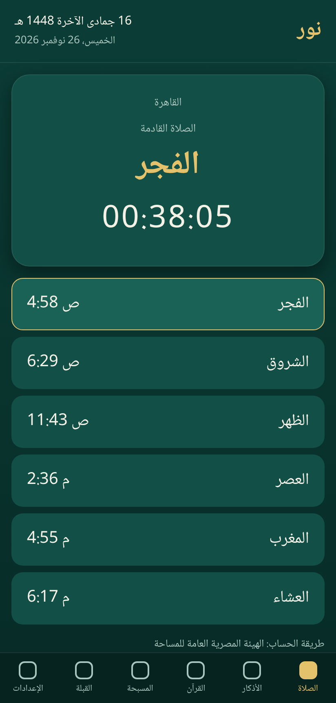
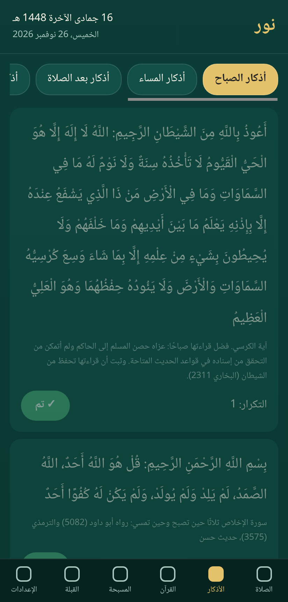
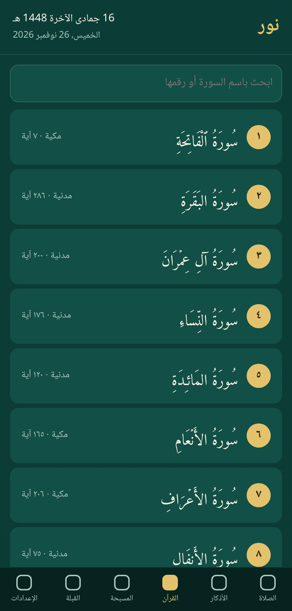
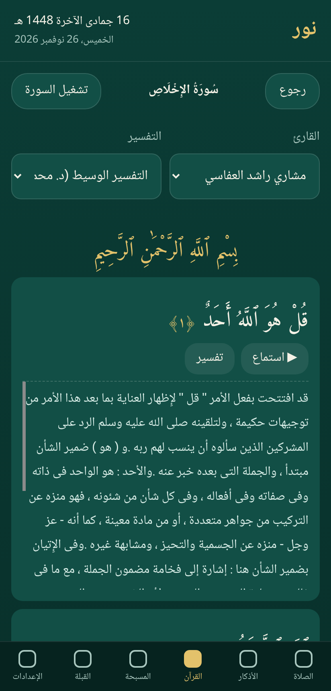
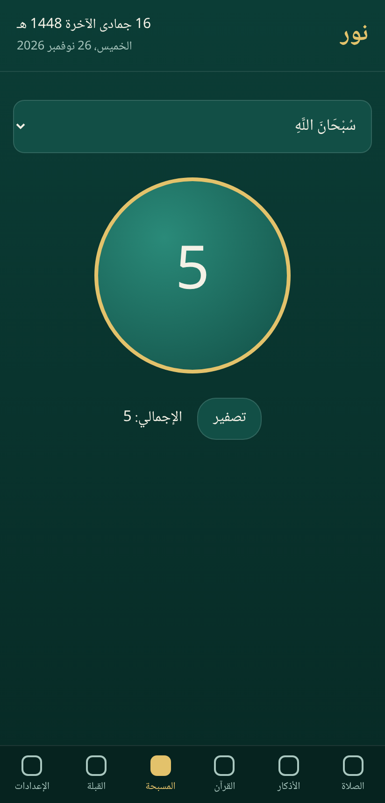
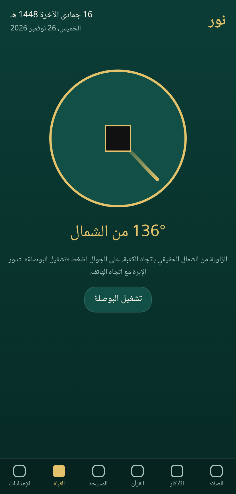
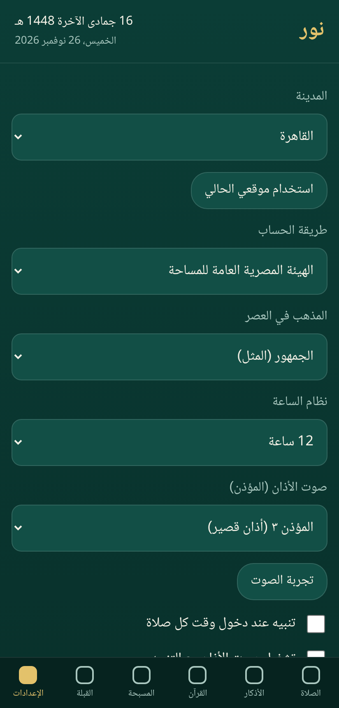
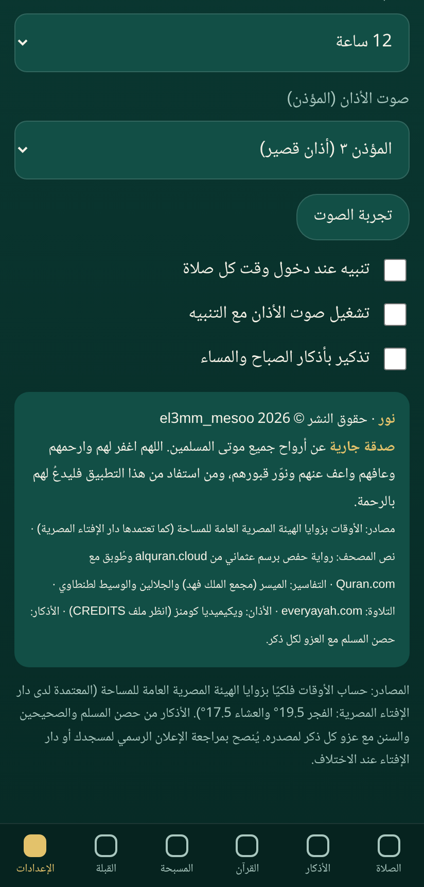

# نور | Noor

**حقوق النشر © 2026 el3mm_mesoo. جميع الحقوق محفوظة.** · Copyright (c) 2026 el3mm_mesoo. **All Rights Reserved.**

Instagram: [@el3mm_mesoo](https://www.instagram.com/el3mm_mesoo/)

[](https://el3mmeso.github.io/noor/) [](https://github.com/El3mMeso/noor/releases/latest)

- **الموقع | Website:** https://el3mmeso.github.io/noor/ (يعمل على الموبايل ويمكن إضافته للشاشة الرئيسية | works on mobile, can be added to the home screen)
- **أندرويد | Android:** https://github.com/El3mMeso/noor/releases/latest (APK موقّع، مع SHA-256 | signed APK with SHA-256)

> **تنبيه | Notice:** لم تتم بعد مراجعة شرعية نهائية للنصوص الدينية. التفاصيل أدناه. | The religious texts have not had a final scholarly review yet. Details below.

<p align="center">




</p>
<p align="center">




</p>

## صدقة جارية | Sadaqah Jariyah

هذا العمل **صدقة جارية على أرواح جميع موتى المسلمين**. اللهم اغفر لهم وارحمهم واجعل هذا العمل في ميزانهم. ومن استفاد منه فلا ينس أن يدعو لهم بالرحمة والمغفرة.

This project is an ongoing charity (sadaqah jariyah) for the souls of all deceased Muslims. May Allah forgive them, have mercy on them, and put this work in their scales. Whoever benefits from it, please do not forget to pray for them for mercy and forgiveness. The dedication must be kept with any copy (see LICENSE).


## تنبيه مهم | Important notice
النصوص الدينية (القرآن، التفسير، الأذكار وعزوها ودرجاتها) **رُوجعت مقابل مصادر مرجعية (مقارنة برمجية)** ولم تخضع بعد **لمراجعة نهائية من عالم شرعي**. المفتوح: عزو آية الكرسي (صباحًا/مساءً للحاكم، وبعد الصلاة للنسائي في الكبرى) لم يُتحقق منه، وألفاظ تسجيلات الأذان لم تُراجع سمعيًا. التفاصيل في `VERIFICATION.md`.

The religious texts were checked programmatically against reference sources but have NOT had a final scholarly review. Open items: Ayat al-Kursi attribution, and the wording of the adhan recordings.

## ما هو؟
تطبيق وموقع عربي (RTL) يضم: مواقيت الصلاة وتنبيهاتها، الأذان بأربعة أصوات، الأذكار (صباح، مساء، بعد الصلاة، نوم، استيقاظ، متنوعة)، القرآن الكريم مع التفسير والتلاوة بثمانية قراء، المسبحة، اتجاه القبلة، التاريخ الهجري.

## النسخ
| النسخة | المجلد | الحالة |
|---|---|---|
| المتصفح / PWA | `web/` | جاهزة وتعمل. شغّلها: `cd web && python3 -m http.server 8000` |
| أندرويد | `native/android` | APK موقّع في صفحة الإصدارات (Capacitor) |
| آيفون | `native/ios` | مشروع Xcode جاهز، لم يُبنَ (يحتاج Mac وحساب Apple Developer) |

## البناء
```
cd native && npm ci
npx cap sync android && cd android && ./gradlew assembleDebug     # JDK 21 + Android SDK 35
npx cap sync ios && npx cap open ios                               # على Mac
```
اختبارات: `node tests/prayer.test.js` و `node tests/e2e.js` (يحتاج Chrome). تقارير التحقق من المصادر في `verification/`.

## المصادر والتحقق
انظر `VERIFICATION.md` و `CREDITS.md`. **المراجعة الشرعية النهائية من جهة علمية مختصة (الأزهر/دار الإفتاء) لم تتم بعد وهي شرط قبل النشر العام.**
